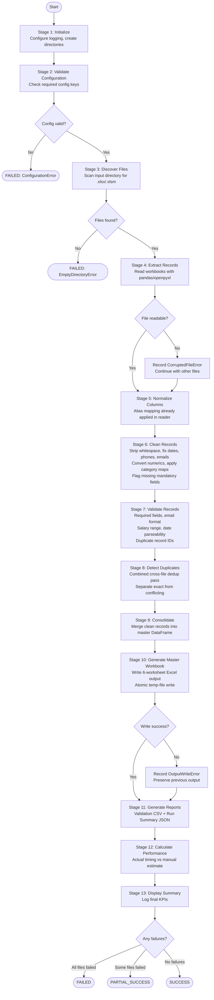

# RPA Workflow Documentation

## Workflow Overview

The automation runs as a 13-stage linear pipeline. Each stage has a single
responsibility, records its duration, and passes structured results to the next stage.
Stages 1–3 are critical: a failure there aborts the pipeline. Stages 4–13 handle
failures gracefully, continuing with remaining files wherever possible.

## Mermaid Flowchart

## Stage Details

### Stage 1 — Initialize
- Creates `logs/`, `reports/`, and `data/output/` directories.
- Attaches a timestamped `FileHandler` to the root logger.
- Generates the timestamp token used in all output filenames.
- **Output:** log file path.

### Stage 2 — Validate Configuration
- Checks that `input_directory` and `output_directory` keys exist in the config.
- **Output:** list of validated keys.
- **Critical:** pipeline aborts on failure.

### Stage 3 — Discover Files
- Calls `file_discovery.discover_files()`.
- Ignores `~$*` temp files and files inside the output directory.
- **Output:** list of `FileInfo` objects.
- **Critical:** pipeline aborts if no processable files found.

### Stage 4 — Extract Records
- Opens each workbook with `pd.read_excel(..., dtype=str)` via `ExcelFile`.
- Column names are normalised to `snake_case` and alias-mapped in the reader.
- Each row is tagged with `_source_file` and `_source_sheet`.
- **Failure behaviour:** logs `CorruptedFileError`; marks file as FAILED; continues.

### Stage 5 — Normalize Columns
- Column normalisation is already performed inside `excel_reader.py` during stage 4.
- This stage records the total number of columns remapped across all files for reporting.
- **Output:** count of remapped columns.

### Stage 6 — Clean Records
- Runs the full cleaning pipeline from `data_cleaner.clean_dataframe()`.
- Produces one `CleaningAudit` per file, collected into `cleaning_summary`.
- **Output:** cleaned DataFrames, audit trail.

### Stage 7 — Validate Records
- Runs `data_validator.validate_dataframe()` per file.
- Splits each file's records into `valid_df`, `review_df`, `invalid_df`.
- All exception records (review + invalid) are concatenated into `exceptions_df`.
- **Output:** `ValidationReport` per file.

### Stage 8 — Detect Duplicates
- Combines all valid + review records from every file into a single DataFrame.
- Runs `data_cleaner.detect_duplicates()` once on the combined dataset.
- This ensures cross-file duplicates (e.g. EMP0025 in both north and south files)
  are detected.
- Exact duplicates and conflicting duplicates are kept in `duplicates_df`.
- Clean records are split back by `_source_file` for source-count attribution.
- **Output:** `duplicates_df`, `valid_for_consolidation` list.

### Stage 9 — Consolidate
- Calls `data_consolidator.consolidate()` on the deduplicated records.
- Computes the column union across all sources.
- **Output:** `master_df`, per-source row counts.

### Stage 10 — Generate Master Workbook
- Calls `excel_exporter.export_master_workbook()`.
- Writes to a temp file, then atomically renames to the target path.
- **Failure behaviour:** logs `OutputWriteError`; preserves the previous output file.

### Stage 11 — Generate Reports
- Saves `reports/validation_errors_<ts>.csv`.
- **Output:** CSV file path.

### Stage 12 — Calculate Performance
- Calls `PerformanceMetrics.calculate()` with the actual `total_duration_s`.
- Saves `reports/run_summary_<ts>.json`.
- **Output:** `PerformanceMetrics` stored in `WorkflowResult.metrics`.

### Stage 13 — Display Summary
- Logs all KPI metrics at INFO level.
- No side effects — informational only.

## Workflow Status Model

| Status | Meaning |
|--------|---------|
| `PENDING` | Not yet started |
| `RUNNING` | Actively executing |
| `SUCCESS` | All stages and files completed without error |
| `PARTIAL_SUCCESS` | At least one file succeeded; at least one failed |
| `FAILED` | Critical stage failed, or every input file failed |

## Exception Handling Policy

| Stage | On failure | Pipeline continues? |
|-------|-----------|-------------------|
| Initialize | Logs error | No (fatal) |
| Validate Configuration | Raises `ConfigurationError` | No (fatal) |
| Discover Files | Raises `EmptyDirectoryError` | No (fatal) |
| Extract Records | Logs `CorruptedFileError` / `FilePermissionError` | Yes (skips file) |
| Clean Records | Logs error | Yes (skips file) |
| Validate Records | Logs error | Yes (skips file) |
| Detect Duplicates | Logs error, uses all valid records | Yes |
| Consolidate | Logs error | Yes |
| Generate Workbook | Logs `OutputWriteError` | Yes (reports stage continues) |
| Reports | Logs error | Yes |
| Performance | Logs error | Yes |

## Inputs and Outputs

**Inputs:**
- `data/input/*.xlsx` — source Excel workbooks
- `config/settings.json` — all business rules

**Outputs:**
- `data/output/Master_Consolidated_<timestamp>.xlsx` — master workbook
- `reports/validation_errors_<timestamp>.csv` — machine-readable error list
- `reports/run_summary_<timestamp>.json` — JSON KPIs
- `logs/rpa_run_<timestamp>.log` — full execution log
